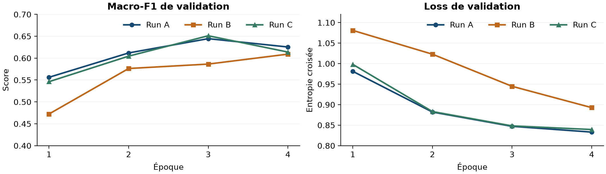
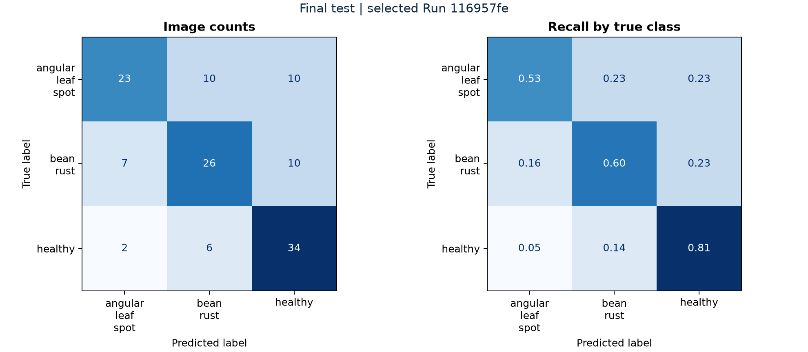

# AI53 - Projet MLOps, phase 1

## Pipeline reproductible de classification de feuilles de haricot

**Étudiant :** Mansour Thomas Yazan<br/>
**Expériences :** 19 novembre 2026 - **Rapport mis en forme :** 21 novembre 2026<br/>
**Dépôt de remise :** <https://github.com/SpeedTomy/AI53-Phase1-MLOps>

### Synthèse

Le projet transforme le CNN fourni en une chaîne d'entraînement traçable : contrôle des données, préparation, entraînement des candidats, sélection sur validation et évaluation finale. Les jalons 0 à 8 du guide ont été réalisés en conservant le réseau, les tests du cours et le verrou de dépendances.

Trois expériences contrôlées ont été comparées sur la macro-F1 de validation à la dernière époque. Le modèle A a été sélectionné avant de consulter le test. Il obtient ensuite **64,84 % d'accuracy et 64,45 % de macro-F1 sur 128 images test**. Les **19 tests du cours passent**. Ces résultats établissent le fonctionnement du pipeline ; une seule graine et un petit jeu de validation limitent la portée de la comparaison des réglages.

### Données et protocole

Le jeu public iBean / Beans, attribué au Makerere AI Lab et à NaCRRI, contient trois classes : `angular_leaf_spot`, `bean_rust` et `healthy`. Les archives exactes du cours contiennent 1 295 images, contre 1 296 annoncées pour la collection d'origine. Les archives utilisées sont vérifiées par SHA-256 ; l'attribution et la licence MIT sont conservées dans [DATASET_SOURCE.md](DATASET_SOURCE.md).

| Ensemble | Images | Rôle dans l'expérience |
|---|---:|---|
| Entraînement | 1 034 | Apprentissage des poids du CNN |
| Validation | 133 | Comparaison des candidats et sélection |
| Test | 128 | Mesure finale après gel du modèle choisi |

Les images sont converties en RGB et redimensionnées à 96 × 96 pixels. La normalisation est appliquée au chargement des tenseurs. Chaque candidat est entraîné sur CPU pendant quatre époques, avec une graine fixée à 42. Le réseau conserve ses trois blocs convolutifs fournis par le cours.

### Organisation de la chaîne

```text
Images brutes -> VALIDATE -> PREPARE -> TRAIN -> candidats MLflow
                                |
                                +-> test préparé -> EVALUATE
                                                      ^
                                sélection sur validation + modèle MLflow
```

Git conserve le code et la configuration ; uv reconstruit l'environnement ; DVC suit les données et les dépendances ; MLflow enregistre les expériences ; pytest vérifie les contrats du code. TRAIN et EVALUATE constituent deux branches distinctes après PREPARE.

<!-- pagebreak -->

## 1. Audit initial et reproductibilité

### Jalon 0 - Constats sur le starter

Les fichiers de la distribution ont été vérifiés avec `MANIFEST.sha256` avant modification. Les tests initiaux donnaient **11 échecs et 8 réussites**. L'audit a identifié les éléments suivants.

| Élément | Problème observé | Correction ou contrôle |
|---|---|---|
| `reproducibility.py` | NumPy, Torch, générateur et workers incomplets | Initialiser les sources aléatoires ; tests dédiés |
| `validate_data.py` | Validateur non implémenté | Contrôler structure, effectifs et décodage complet |
| `provenance.py` | Manifeste de Run absent | Capturer Git, données, versions et configuration |
| `train.py` | Journalisation MLflow incomplète | Paramètres, Dataset, métriques, artefacts et modèle |
| `dvc.yaml` | Pipeline non défini | Quatre étapes avec dépendances et paramètres précis |
| Données brutes | Images non suivies par DVC | Vérifier les archives, extraire, versionner et sauvegarder |
| Environnement | Python courant 3.14 incompatible avec le starter | Environnement Python 3.12 isolé et verrou inchangé |
| Sélection et conservation | Aucun candidat choisi ni sauvegarde MLflow | Comparaison sur validation, gel du Run ID et sauvegarde Phase 2 |

**Checkpoint 1 - Pourquoi un fichier `model.pt` ne suffit-il pas ?** Un modèle seul ne reconstitue ni le code utilisé, ni les données, les versions, les graines et les réglages, ni les mesures ayant motivé sa sélection. Ces informations doivent être reliées au même entraînement.

### Jalon 1 - Environnement et graines

`pyproject.toml` décrit les exigences du projet. `uv.lock` fige les versions résolues et leurs sources. `.venv/` est l'installation locale, recréable à partir de ces deux fichiers. Le verrou fourni a été conservé, et le contrôle d'environnement affiche **SETUP PASS** sur Python 3.12.14.

La fonction `set_reproducibility` initialise Python `random`, NumPy, Torch CPU et les dispositifs CUDA lorsqu'ils sont disponibles. Le générateur du DataLoader fixe l'ordre de mélange ; chaque worker initialise Python et NumPy à partir de la graine donnée par Torch. Les options cuDNN déterministes sont activées et son benchmark est désactivé.

**Checkpoint 2 - La graine 42 garantit-elle une identité universelle ?** Elle contrôle les tirages dans un environnement donné. Elle ne garantit pas des résultats bit à bit identiques entre architectures CPU/GPU, versions logicielles ou algorithmes numériques différents.

Une adaptation du script de contrôle a été nécessaire sur macOS : suivre le lien symbolique de `.venv/bin/python` désignait le Python de base et produisait un faux échec. Le contrôle utilise désormais `sys.prefix` pour identifier l'environnement actif. Les tests du cours sont inchangés.

<!-- pagebreak -->

## 2. Versionnement, qualité et pipeline des données

### Jalons 2 et 3 - Acquisition et barrière qualité

Les trois archives ont passé leur vérification SHA-256 avant extraction. Le validateur contrôle la présence des ensembles, les trois classes exactes, les effectifs attendus, l'absence de classe vide et le décodage de tous les pixels avec Pillow. Une image illisible ou une structure incorrecte provoque une erreur et bloque la suite de la chaîne.

| Classe | Train | Validation | Test |
|---|---:|---:|---:|
| `angular_leaf_spot` | 345 | 44 | 43 |
| `bean_rust` | 348 | 45 | 43 |
| `healthy` | 341 | 44 | 42 |
| **Total** | **1 034** | **133** | **128** |

Le rapport `reports/data_quality.json` donne **PASS, 1 295 images**. Il ne contient pas d'horodatage : sur des données identiques, son contenu reste identique. Les tests couvrent notamment fichier corrompu, ensemble absent, classe supplémentaire, classe vide, effectif erroné et stabilité du rapport.

Les données brutes sont suivies par `data/raw.dvc`. Le remote DVC `lab-data` est un dossier local voisin du projet. Les données et checkpoints de l'historique y ont été sauvegardés avec `dvc push --all-commits`.

**Checkpoint 3 - Que transportent les remotes ?** Le remote Git reçoit le code, les réglages, les rapports et les pointeurs DVC. Le remote DVC reçoit les octets des données et sorties mises en cache. Un `git push` ne transfère pas les images : un `dvc push` est également nécessaire.

### Jalon 4 - Quatre étapes déclarées dans `dvc.yaml`

| Étape | Entrées principales | Sorties principales |
|---|---|---|
| VALIDATE | Images brutes et code de validation | Rapport qualité déterministe |
| PREPARE | Images brutes, rapport qualité, taille cible | Images RGB redimensionnées, manifestes et résumé |
| TRAIN | Train/validation préparés et réglages d'entraînement | Checkpoint, courbes, scores, provenance et candidat MLflow |
| EVALUATE | Test préparé, Run sélectionné et identité des données | Scores test et matrice de confusion |

PREPARE dépend du rapport qualité **et des images brutes** : des effectifs inchangés ne garantissent pas des images inchangées. Les manifestes enregistrent les chemins, étiquettes et SHA-256 des fichiers sources et préparés. L'identité des données d'entraînement combine les manifestes train et validation.

Chaque étape déclare ses imports locaux, `pyproject.toml`, `uv.lock` et les paramètres qu'elle utilise. Les images, manifestes et checkpoints sont dans le cache DVC ; les petits rapports sont conservés dans Git avec `cache: false`. Les JSON de scores sont déclarés comme métriques. Le DAG vérifié sépare TRAIN et EVALUATE : le test final charge le modèle sélectionné dans MLflow.

<!-- pagebreak -->

## 3. Provenance MLflow et comportement des recalculs

### Jalon 5 - Enregistrement de chaque expérience

Chaque exécution TRAIN crée un Run dans `bean-image-classification`. Le manifeste de provenance est capturé au début du Run, avant l'écriture des sorties d'entraînement. Il enregistre commit Git, état local, identité des données, versions logicielles, dispositif, graine, configuration et Run ID.

MLflow conserve les onze paramètres requis, le Dataset `bean-training` de contexte `training` et de cible `label`, puis les quatre métriques par époque : `train_loss`, `val_loss`, `val_accuracy`, `val_macro_f1`. Le temps total d'entraînement et les trois artefacts demandés sont également enregistrés : courbes, résumé et manifeste.

Le modèle final `bean-cnn` est sauvegardé sur CPU, en mode évaluation, avec le code de sa classe, une signature, un exemple d'entrée et les métadonnées `class_names` et `image_size`. L'exemple provient de la validation. `scripts/inspect_runs.py` a vérifié ces enregistrements sur les trois Runs terminés, ainsi que la correspondance entre les scores finaux et l'époque 4.

**Checkpoint 4 - Rôle des trois outils.** Git identifie le code et les réglages sauvegardés. DVC relie les états des données, paramètres et sorties. MLflow conserve les preuves propres à chaque entraînement et son modèle.

### Jalon 6 - Prédictions fixées avant entraînement

Hypothèse du guide : toutes les sorties, test compris, sont à jour ; le Run sélectionné reste fixe. « Réutilisé » signifie que DVC conserve les sorties de l'étape.

| Changement isolé | VALIDATE | PREPARE | TRAIN | EVALUATE |
|---|---|---|---|---|
| Taux d'apprentissage | Réutilisé | Réutilisé | Relancé | Réutilisé |
| Taille des images | Réutilisé | Relancé | Relancé | À revalider |
| Commentaire du validateur, rapport inchangé | Relancé | Réutilisé | Réutilisé | Réutilisé |
| README uniquement | Réutilisé | Réutilisé | Réutilisé | Réutilisé |

**Checkpoint 5 - Justification.** Le taux d'apprentissage est une entrée de TRAIN uniquement. Un commentaire modifie l'empreinte du validateur ; si son JSON reste identique, les entrées de PREPARE puis de TRAIN restent identiques. Changer la taille modifie les données préparées : l'ancien Run sélectionné peut être rejeté pour incompatibilité.

| Vérification réellement exécutée | VALIDATE | PREPARE | TRAIN | EVALUATE |
|---|---|---|---|---|
| Première baseline A | Relancé | Relancé | Relancé | Non exécuté |
| Sans changement | Réutilisé | Réutilisé | Réutilisé | Non exécuté |
| Commentaire dans le validateur | Relancé | Réutilisé | Réutilisé | Non exécuté |
| Taux à 0,0003 pour B | Réutilisé | Réutilisé | Relancé | Non exécuté |

Les résultats confirment les prédictions. Après le commentaire, le SHA-256 du rapport qualité est inchangé ; DVC affiche ensuite `Stage 'prepare' didn't change, skipping` et le même message pour TRAIN. Aucun Run supplémentaire n'est créé par ces deux contrôles. Les extraits sont conservés dans `reports/evidence/`.

<!-- pagebreak -->

## 4. Comparaison de trois expériences contrôlées

### Jalon 7 - Protocole et hypothèses

Les trois essais utilisent les mêmes données, la graine 42, quatre époques, des images 96 × 96, un batch de 32 et aucune augmentation. A est la référence : learning rate 0,001 et dropout 0,30. Les paramètres de B et C ont été sauvegardés dans Git avant leur entraînement.

**Hypothèse B, formulée avant l'essai :** abaisser le learning rate à 0,0003 peut ralentir la convergence sur quatre époques, avec un score final plus faible. **Hypothèse C :** augmenter uniquement le dropout à 0,50 peut limiter le surapprentissage, mais aussi ralentir l'apprentissage de ce petit réseau. C reprend le learning rate de A.

La règle de sélection fixée avant l'entraînement maximise la macro-F1 de validation à la **dernière époque**, puis l'accuracy, puis minimise la loss ; une égalité complète favoriserait A, B, C dans cet ordre. Le temps reste descriptif, car il dépend de la charge de la machine.

| Run | Changement face à A | Accuracy val. | Macro-F1 val. | Loss val. | Temps (s) |
|---|---|---:|---:|---:|---:|
| **A** | Référence | **0,639098** | **0,625419** | **0,833060** | 13,068 |
| B | LR = 0,0003 | 0,616541 | 0,609117 | 0,892707 | 13,358 |
| C | Dropout = 0,50 | 0,624060 | 0,613860 | 0,839332 | 13,290 |



*Figure 1. Macro-F1 et loss de validation par époque, extraites des historiques MLflow. La sélection porte sur les modèles de l'époque 4.*

B présente un score final inférieur et une loss plus élevée que A, ce qui est compatible avec une convergence plus lente. Cela ne démontre pas qu'un plus petit taux serait moins bon avec un entraînement plus long.

L'essai C ne confirme pas un bénéfice du dropout renforcé dans ce protocole. Sa macro-F1 atteint 0,651097 à l'époque 3, puis descend à 0,613860 à l'époque 4 ; A baisse aussi après l'époque 3. On compare les modèles finaux effectivement sauvegardés, sans sélectionner rétrospectivement une époque non livrée.

**Checkpoint 6 - Métrique principale.** La macro-F1 combine précision et rappel pour chaque classe, puis donne le même poids aux trois classes. Elle complète l'accuracy globale. Une seule graine et 133 images de validation ne suffisent pas à établir un avantage général d'un hyperparamètre.

<!-- pagebreak -->

## 5. Sélection du modèle et évaluation finale

### Jalon 8 - Choix gelé sur la validation

Le Run **A** est retenu pour sa macro-F1 de validation **0,625419**. Aucun départage n'est nécessaire ; l'accuracy et la loss finales sont également favorables à A. Son identifiant est enregistré dans `selection.run_id` et la décision est sauvegardée au commit `2a415b2`, avant de scorer le test.

```text
Run sélectionné : 116957febf994489ac92baa3458f3d34
Modèle MLflow : runs:/116957febf994489ac92baa3458f3d34/bean-cnn
```

Les autres réglages restent ceux de C, conformément au guide. Le checkpoint local `models/model.pt` est donc celui de C. EVALUATE recharge A depuis MLflow : le Run sélectionné, et non le dernier checkpoint produit, fait autorité.

L'évaluateur vérifie le statut FINISHED, l'expérience, la taille des images, l'ordre des classes et l'identité des données train/validation. `dvc repro evaluate` réutilise VALIDATE et PREPARE, puis exécute uniquement EVALUATE. Le jeu test est scoré lors d'une seule exécution, après la sélection.

| Mesure sur 128 images test | Résultat |
|---|---:|
| Accuracy | **0,6484375 (64,84 %)** |
| Macro-F1 | **0,6444771 (64,45 %)** |
| Images correctement classées | **83 / 128** |



*Figure 2. Test final du Run A : effectifs à gauche et rappel par classe à droite. Les lignes représentent les classes réelles et les colonnes les prédictions.*

Le modèle reconnaît correctement 23/43 images `angular_leaf_spot`, 26/43 `bean_rust` et 34/42 `healthy`. La classe saine est mieux reconnue ; les confusions entre maladies et feuilles saines limitent encore la qualité du modèle.

**Pourquoi réserver le test ?** Consulter ses scores pour régler ou sélectionner les candidats adapterait les décisions à cet ensemble et biaiserait l'estimation finale. Aucun réglage n'a été modifié en fonction du score test.

Le score reste modeste, et le protocole ne démontre pas une robustesse agronomique hors du jeu fourni. Une comparaison multi-graines ou plus longue constituerait une étude distincte, avec un protocole fixé avant toute nouvelle utilisation du test.

<!-- pagebreak -->

## 6. Traçabilité, vérifications et accès au rendu

### Identifiants et environnement des expériences

| Run | Identifiant MLflow | Commit avant entraînement |
|---|---|---|
| A | `116957febf994489ac92baa3458f3d34` | `c9ee6e6` |
| B | `37c50006d9d548aba01e852501fa6aa6` | `ae98ef8` |
| C | `ed08edffe9c248df894db2ec166df2d0` | `997604d` |

Les trois Runs sont FINISHED et partagent l'identité des données préparées ci-dessous. Elle est calculée à partir des manifestes et inclut les empreintes des images préparées.

```text
8fa943ff6c17a3c874d2b152e9d7980602a5cd50c0d8156625bd00590a3d8c6c
```

Les manifestes indiquent Python 3.12.14, Torch 2.11.0, torchvision 0.26.0, DVC 3.67.1 et MLflow 3.17.1, sur macOS ARM64, dispositif CPU. Les réglages et versions détaillés sont disponibles dans `reports/runs/A`, `B` et `C`.

Le drapeau Git `dirty=true` est conservé dans les trois manifestes. Pour A, des sorties de PREPARE et `dvc.lock` n'étaient pas encore commitées ; pour B et C, DVC retire les rapports de sortie suivis dans Git avant TRAIN. Les commits de code et de configuration restent identifiés. Les commits automatiques utilisent l'identité technique `AI53 Lab`.

### Vérifications et preuves

Les **19 tests du cours passent**. Le contrôle d'environnement est validé ; DVC indique que les données et le pipeline sont à jour. Le CNN, les tests, les modules fournis hors fonctions à compléter, `pyproject.toml` et `uv.lock` sont inchangés octet pour octet ; les empreintes de contrôle sont conservées.

| Preuve | Emplacement dans le dépôt |
|---|---|
| Qualité et préparation des données | `reports/data_quality.json`, `reports/data_summary.json` |
| Paramètres, scores et séries des trois Runs | `reports/experiment_comparison.json` |
| Courbes, résumés et provenance de chaque Run | `reports/runs/A`, `reports/runs/B`, `reports/runs/C` |
| Recalculs DVC, tests et fichiers préservés | `reports/evidence/` |
| Scores et matrice du test final | `reports/test_metrics.json`, `reports/test_confusion_matrix.png` |

### Remise et continuité en Phase 2

Le rendu comprend l'URL du dépôt, ce rapport en Markdown et sa version PDF. Le code, les preuves et l'historique sont consultables sur GitHub. Les images, caches et données MLflow restent hors de l'historique Git ; le remote DVC est local et ne se récupère pas par un simple clone.

Pour la Phase 2, une sauvegarde locale conserve le dépôt, le remote DVC, `mlflow.db` et `mlartifacts/`. Elle a été créée après arrêt du serveur et restaurée dans un dossier indépendant : données DVC, base intègre et trois modèles vérifiés. La procédure est décrite dans [docs/RESTORE_PHASE2.md](docs/RESTORE_PHASE2.md).

Le modèle attend un tenseur float32 NCHW `(-1, 3, 96, 96)`, avec conversion RGB, resize bilinéaire et normalisation moyenne/écart-type `(0.5, 0.5, 0.5)`. Il renvoie trois logits dans l'ordre `angular_leaf_spot`, `bean_rust`, `healthy`.

**Références :** guide officiel [AI53 Phase 1](docs/AI53_Phase1_Lab_Guide.pdf) ; notes [MLflow](docs/MLFLOW_API_REFERENCE.md) ; attribution et licence [Beans](DATASET_SOURCE.md).
