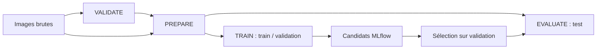

# AI53 - Pipeline MLOps de classification de feuilles de haricot

Projet de laboratoire, phase 1 - UTBM. **Mansour Thomas Yazan**.

Le projet construit une chaîne reproductible autour du CNN fourni : validation des données Beans, préparation, trois entraînements contrôlés, sélection sur validation et test final du modèle retenu.

## Consulter le rendu

- **[Rapport PDF](output/pdf/AI53_Phase1_Rapport.pdf)** - version mise en page pour la lecture et la correction.
- **[Rapport Markdown](LAB_REPORT.md)** - réponses aux jalons 0 à 8 et aux six checkpoints.
- [Comparaison des expériences](reports/experiment_comparison.json), [scores test](reports/test_metrics.json) et [matrice de confusion](reports/test_confusion_matrix.png).
- [Guide du laboratoire](docs/AI53_Phase1_Lab_Guide.pdf) et [attribution / licence des données](DATASET_SOURCE.md).

## Résultats

| Run | Modification par rapport à A | Accuracy validation | Macro-F1 validation |
|---|---|---:|---:|
| **A** | Référence : LR 0,001 ; dropout 0,30 | **0,639098** | **0,625419** |
| B | Learning rate 0,0003 | 0,616541 | 0,609117 |
| C | Dropout 0,50 | 0,624060 | 0,613860 |

Les données, la graine 42, les quatre époques, le batch de 32 et l'absence d'augmentation sont communs. Les scores correspondent à la dernière époque. **A a été sélectionné avant l'évaluation test** : accuracy **64,84 %**, macro-F1 **64,45 %** sur 128 images. Une seule graine et un petit jeu de validation limitent la généralisation de cette comparaison.

## Pipeline et outils



Git conserve le code, la configuration et les preuves ; uv verrouille l'environnement ; DVC suit les données et les dépendances ; MLflow conserve les Runs et modèles ; pytest vérifie les contrats du code. Les commandes des quatre étapes sont dans [dvc.yaml](dvc.yaml).

## Installation et contrôles

Pré-requis : Git, uv et Python 3.12. Depuis la racine du dépôt :

```bash
uv sync --locked --python 3.12
uv run --locked python scripts/check_environment.py
uv run --locked pytest -q
```

La suite du cours compte **19 tests réussis**. Le modèle, les tests et le verrou fournis sont préservés ; les contrôles et empreintes se trouvent dans [reports/evidence/](reports/evidence/).

Les images et les données MLflow ne sont pas incluses dans Git. Un clone permet de consulter le rendu et de lancer les tests unitaires, mais ne contient pas le stockage DVC local ni les trois modèles historiques. La sauvegarde Phase 2 les conserve ; voir [la procédure de restauration](docs/RESTORE_PHASE2.md).

Si le cache système DVC n'est pas accessible :

```bash
mkdir -p .dvc/site-cache
uv run --locked dvc config --local core.site_cache_dir "$PWD/.dvc/site-cache"
```

## Reconstituer les données pour un nouvel entraînement

Les scripts téléchargent les trois archives publiques, vérifient leurs SHA-256 et extraient les 1 034 images train, 133 validation et 128 test :

```bash
uv run --locked python scripts/download_dataset.py
uv run --locked python scripts/check_dataset.py
```

Avec les archives fournies par le cours, utiliser `python scripts/download_dataset.py --archive-dir dataset-archives` via `uv run --locked`. Avec la sauvegarde complète restaurée, `uv run --locked dvc pull` récupère les images et checkpoints depuis le remote voisin.

Pour lancer MLflow, dans un premier terminal :

```bash
uv run --locked mlflow server --host 127.0.0.1 --port 5000 --workers 1 --backend-store-uri sqlite:///mlflow.db
```

Ouvrir <http://127.0.0.1:5000>. Dans un second terminal, `uv run --locked dvc repro train` exécute la branche d'entraînement si ses entrées ont changé. Les réglages actuels de TRAIN correspondent à C ; les paramètres historiques de A et B restent dans Git et dans les manifestes des Runs.

Le test final enregistré porte sur A. Les données historiques MLflow sont nécessaires pour recharger son Run ID ; un nouveau serveur vide ne les reconstitue pas. Les résultats de test déjà fournis servent à la remise et n'ont pas guidé le réglage des candidats.

## Modèle sélectionné et Phase 2

- Run retenu : `116957febf994489ac92baa3458f3d34`.
- Modèle : `runs:/116957febf994489ac92baa3458f3d34/bean-cnn`.
- Entrée : float32 NCHW `(-1, 3, 96, 96)`, RGB, resize bilinéaire, normalisation moyenne / écart-type `(0.5, 0.5, 0.5)`.
- Sortie : trois logits, dans l'ordre `angular_leaf_spot`, `bean_rust`, `healthy`.

Le checkpoint local `models/model.pt` correspond à C ; la sélection finale recharge A depuis MLflow. Conserver le dépôt, le remote DVC, `mlflow.db` et `mlartifacts/`. Arrêter le serveur avant toute sauvegarde de sa base.

## Repères dans le dépôt

| Emplacement | Contenu |
|---|---|
| `src/` | Étapes du pipeline, CNN et fonctions de reproductibilité / provenance |
| `tests/` | Tests du cours |
| `params.yaml`, `dvc.yaml`, `dvc.lock` | Configuration, dépendances et états du pipeline |
| `reports/runs/` | Courbes, résumés et manifestes de A, B et C |
| `reports/evidence/` | Extraits d'exécution et vérifications |
| `docs/` | Guide, références et restauration |
| `output/pdf/` | Rapport final mis en page |

La distribution originale du cours est conservée séparément. `docs/distribution/MANIFEST.sha256` décrit les fichiers de cette distribution, et non l'arborescence modifiée du projet.
